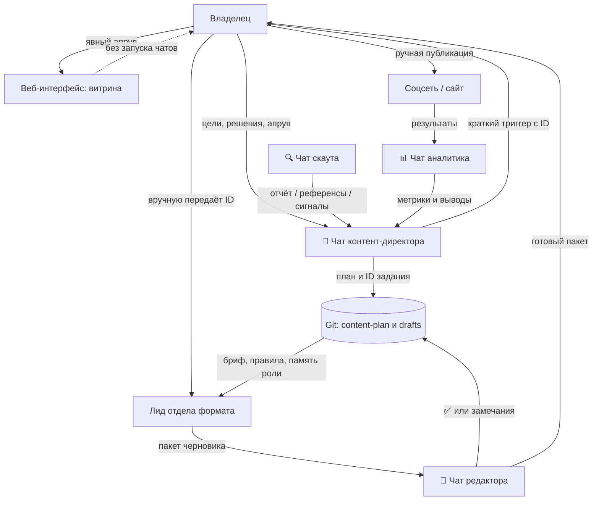

# Ручная архитектура контент-фабрики на первый месяц

> Статус: рабочая договорённость. Период: один месяц с даты принятия.
> Цель: отладить роли, правила, референсы и качество отдельных чатов до запуска автономных агентов.
>
> Этот файл уточняет ручной режим поверх существующих `ARCHITECTURE.md`,
> `shared/rules/agent-roster.md` и `shared/rules/approve-loop.md`. Если в старых
> документах описан автоматический триггер между чатами, на период эксперимента
> действует этот файл: старт следующего чата делает владелец.

## Решение

Фабрика работает через отдельные специализированные чаты. Они **не вызывают друг друга автоматически**. Владелец вручную передаёт каждому чату ID задания и путь к нему в репозитории. Это сознательный режим обучения, а не временная поломка.

Git — каноническое хранилище задания и результатов. Веб-интерфейс — витрина плана, статуса и готовых материалов. Чат — рабочее место конкретного специалиста и канал для обсуждения с владельцем.

## Схема взаимодействия



Стрелки владельца между чатами намеренно ручные. Один чат не имеет доступа к
неявной истории другого: он получает ID и читает только определённые для роли файлы.

## Роли и границы

| Роль / чат | Создаёт | Получает | Не делает |
|---|---|---|---|
| Контент-директор | месячный план, брифы, задания | цели, результаты скаута и аналитика | не производит финальные материалы за отделы |
| Скаут | исследовательские отчёты, референсы, сигналы | задача исследования | не меняет утверждённый план |
| Начальник формата | черновик, производственную цепочку, пакет на редактуру | ID и бриф директора, референсы отдела | не публикует материал |
| Редактор | вердикт и замечания | пакет отдела | не подменяет собой владельца |
| Владелец | старт задания, правки, апрув и ручная публикация | готовый пакет и статус | не обязан переносить контекст между ролями вручную: передаётся ID |

Внутренние цепочки уже определены в `shared/pipelines/`: карусели идут через
сценарий → визуальный план → дизайн/композит → редактуру; рилсы — через сценарий
→ материалы → монтаж → редактуру; статьи — через текст → визуальные брифы →
редактуру. Лид отдела выбирает только свою цепочку, не подменяет директора или редактора.

## Одна единица контента

Каждая единица имеет ID формата `V-ГГГГММ-NN` и хранится в месячном плане. Минимальный бриф содержит: цель, формат, канал, тему, CTA, адресата, дедлайн, входные материалы, ожидаемый результат и критерии приёмки.

Состояния:

```text
план → назначено → в работе → редактура → на апрув → одобрено → опубликовано
                         └──────────────→ нужна доработка
```

Менять статус может только роль, которая завершила свой этап. Публикация возможна только после вердикта редактора и явного подтверждения владельца.

### Где лежат данные одной единицы

| Слой | Каноническое место | Что там хранится |
|---|---|---|
| План и задание | `projects/vernatun/content-plan/ГГГГ-ММ.md` | ID, цель, формат, дата, CTA, статус и адресат |
| Текстовый черновик | `projects/vernatun/drafts/ГГГГ-ММ/` | сценарий, статья, подпись, редакторский вердикт |
| Память роли | `projects/vernatun/memory/<роль>.md` | только принятые уроки этой роли |
| Референсы и медиа | внешнее хранилище или папка отдела; в Git — ссылка и манифест | исходник, права/источник, разбор, готовый файл |
| Веб-интерфейс | существующий Content Factory | отображение плана, статуса и одобренного результата; не заменяет Git |

Доступность VPS и веб-витрины нужно проверять перед отправкой материалов. Если
она недоступна, работа продолжается в Git и внешнем хранилище; статус не объявляется
«размещённым на вебе» без фактической проверки.

## Ручная передача между чатами

Контент-директор пишет задание в `projects/vernatun/content-plan/ГГГГ-ММ.md` и, если доступна витрина, отражает тот же ID и статус там. Затем владелец открывает чат нужного начальника отдела и отправляет короткий триггер:

```text
Возьми в работу V-ГГГГММ-NN.
Прочитай бриф в projects/vernatun/content-plan/ГГГГ-ММ.md,
свои правила и память. Подтверди входные данные, обнови статус и подготовь пакет для редактора.
```

Чат не получает скрытую историю директора. Он читает только канонический бриф и материалы, указанные в нём. Это исключает смешение контекста.

После завершения этапа агент возвращает владельцу ровно четыре вещи: ID, новый
статус, ссылку на пакет и список открытых вопросов. Владелец может одним сообщением
передать это следующей роли. Так цепочка остаётся проверяемой даже при сжатии истории.

## Долгая память агента

Сжатие истории чата происходит автоматически и не является долговременной памятью. У каждого агента есть отдельный файл `projects/vernatun/memory/<роль>.md`. Перед работой агент читает только свою память, актуальный бриф, бренд-гайд и применимые правила.

После принятой правки агент добавляет в свою память короткий датированный урок: что произошло, какое правило меняется, где оно применяется. Референсы хранятся в папке соответствующего отдела или во внешнем хранилище со ссылкой и разбором; не только в сообщениях чата.

## Навыки, плагины и MCP

Правила и роли добавляются в Git, поэтому доступны всем новым чатам с этим репозиторием. Плагины, MCP-подключения, секреты и доступные инструменты зависят от конкретной среды и чата: их наличие всегда проверяется в начале работы. Секреты не записываются в Git или в чат.

Новый навык сначала проверяется на одной тестовой единице контента, затем его правила вносятся в профиль соответствующей роли. Подключение не означает разрешение на публикацию или оплату внешнего сервиса.

## Чего в этом месяце нет

- автоматического запуска одного чата другим;
- фонового расписания агентов;
- автоматической публикации в соцсетях;
- передачи секретов между чатами;
- признания истории чата источником правды вместо Git.
