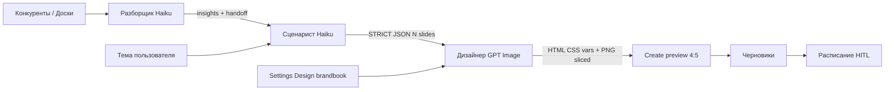

# Vernatun Content Factory — архитектура и стек (аудит)

> Снимок на **2026-10-15** (обновлён: полный реестр модулей, модель автономии, агент-Тренер).  
> Связанный файл функционала: [`AUDIT_FUNCTIONALITY.md`](./AUDIT_FUNCTIONALITY.md).

---

## 1. Что это за система

**Vernatun Content Factory** — модульный AI-завод контента для армянского клуба Vernatun. Целевая модель эксплуатации:

> **Завод работает автономно** (разведка конкурентов → разбор → сценарий → дизайн → очередь).  
> **Человек (владелец/админ) в основном только согласовывает выпуск** — смотрит черновик, жмёт апрув / правит слот в Расписании. Не обязан писать тексты и собирать макеты вручную.

Архитектурная идея:

- не один «магический чат», а **много модулей контента** + **отдельная цепочка агентов на каждый тип**;
- **Human-in-the-Loop на выпуске** (HITL), а не на каждом мелком шаге производства;
- **агент-Тренер** в команде выпуска постоянно предлагает улучшения агентов (промпты, правила, CTA, хуки, дизайн) на основе того, **что сработало у конкурентов** и что показал Разборщик — изменения вносятся **только после согласования с владельцем**;
- владелец настраивает mesh / модели / DESIGN.md; дальше завод крутит конвейер сам.

---

## 2. Стек технологий (as-is)

| Слой | Технология | Версия / заметка |
|------|------------|------------------|
| Framework | **Next.js** App Router | `15.5.25` (Turbopack в `dev`/`build`) |
| UI | **React** | `19.1.0` |
| Стили | **Tailwind CSS** | v4 (`@tailwindcss/postcss`) |
| Язык | **TypeScript** | 5.x |
| ORM / БД | **Prisma** → **PostgreSQL** | `@prisma/client` ^6.19; без `DATABASE_URL` — JSON-fallback аналитики |
| Очереди | **BullMQ** + **Redis** (`ioredis`) | заявлены в стеке; не все пути UI идут через очередь |
| Состояние клиента | **Zustand**, **TanStack Query** | mesh agents, drafts, boards, marketing projects |
| Граф / mesh UI | **@xyflow/react** | `/admin/mesh`, `/studio/[moduleId]/mesh` |
| Карусели UI | **embla-carousel-react**, **framer-motion** | Settings Design, feed preview |
| Валидация | **Zod** | carousel JSON, API payloads |
| Рендер слайдов | **Playwright** (HTML→PNG) | `carousel-html-renderer` / builder |
| LLM | OpenAI-compatible **Aggregator** | `AGGREGATOR_*` env; модели в Settings / mesh |
| IG конкуренты | **Apify** Instagram Scraper | `IG_SCRAPER_API_KEY`; кэш / лимиты (S51) |
| Аватары | **HeyGen** | ключ в env; модуль heygen-reels |
| UI primitives | Radix + shadcn-подобные (`button`, `select`, `ai-input`, …) | `components/ui/` |

### Секреты (только env, не в git)

Типичные: `DATABASE_URL`, `AGGREGATOR_API_KEY`, `AGGREGATOR_BASE_URL`, `IG_SCRAPER_API_KEY`, `HEYGEN_API_KEY`, Redis URL, опционально `USE_FEED_FIXTURES`, `APIFY_IG_MAX_RUNS_PER_HOUR`.

---

## 3. Карта приложения (роуты)

| URL | Назначение |
|-----|------------|
| `/` | → `/studio` |
| `/studio` | Launchpad модулей |
| `/studio/[moduleId]` | Рабочая зона: Наши / Конкуренты / Доски / Разбор / Создать |
| `/studio/[moduleId]/mesh` | Команда выпуска (flowchart агентов модуля) |
| `/studio/inspect/[id]` | HITL-инспектор черновика |
| `/studio/[moduleId]/edit/[draftId]` | CapCut-shell (cartoon / heygen) |
| `/analytics` | KPI / инсайты Analyst |
| `/schedule` | Календарь слотов + очередь HITL |
| `/settings` | LLM-агенты, Design library (brandbook), packs |
| `/brand-kit` | Бренд-кит |
| `/marketing` | Маркетинг-директор (чат + проекты) |
| `/admin/mesh` | OWNER-only canvas агентов |

**RBAC (задумано):** `OWNER` vs `ADMIN`; mesh admin — только OWNER. Реальная авторизация в локальном режиме может быть упрощена (роль в UI/env) — зона аудита.

---

## 4. Модули контента (полный реестр)

Каждый тип контента = **отдельный пайплайн** в mesh (`MESH_PIPELINE_IDS` в `lib/mesh-roles.ts`) и/или манифест в `src/modules/`.

### 4.1 Ядро Studio (манифесты launchpad)

| `moduleId` | Название |
|------------|----------|
| `carousel-engine` | Карусели Instagram 4:5 (**самый зрелый** path: Разбор → Create → drafts) |
| `aesthetic-graphics` | Полезные картинки и инфографика |
| `cartoon-reels` | Мульт-Reels (2D сторителлинг) 9:16 |
| `heygen-reels` | HeyGen AI-аватар Reels |
| `site-articles` | Статьи на сайт |
| `tg-articles` | Статьи / посты в Telegram |

### 4.2 Доп. пайплайны mesh (команда выпуска)

| `moduleId` | Название |
|------------|----------|
| `custom-reels` | Рилс (вертикальный, сценарист + монтажёр) |
| `custom-clips-to-reels` | Нарезки длинного видео в рилсы |
| `custom-info-video` | Информационное видео |

### 4.3 Расширение

- Слот **custom remote / register** (`/api/modules/register`) — подключение внешнего модуля по SDK.
- Не один universal graph: у каждого `moduleId` свой flowchart агентов.

**Итого в продуктовой карте:** 6 плиток ядра + 3 custom-video пайплайна + plugin slot ≈ **9+ каналов контента**.

---

## 5. Слои кода

```
app/                    # Next App Router: pages + api/*
components/             # UI: studio, settings, marketing, mesh, ui
lib/                    # бизнес-логика: studio, settings, llm, mesh, db
prisma/                 # schema + migrations + seed
workers/                # skills операционных агентов контента (не Cursor-команда)
.cursor/                # rules, skills, registry команды разработки
docs/                   # архитектура, циклы, аудит
memory/                 # журналы волн/тикетов (агенты)
generatedMedia/         # артефакты PNG волн / локальный рендер
```

### Ключевые API (выборка)

| Группа | Примеры |
|--------|---------|
| Studio feed | `GET /api/studio/[moduleId]/feed` |
| Agent chat | `POST /api/studio/agent-chat` |
| Razbor live | `POST /api/studio/razbor/analyze` |
| Carousel draw | `POST /api/studio/carousel-engine/generate-slides` |
| Design | `POST /api/settings/design-deconstruct`, `design-razbor`, `design-active` |
| Marketing | `POST /api/marketing/chat`, `GET/POST /api/marketing/search` |
| Jobs SSE | `GET /api/jobs/[id]/stream` |
| Analytics | `ingest`, `insights`, `snapshot` |
| Modules SDK | `register`, `generate`, `render`, `regenerate` |

---

## 6. Данные

### Prisma (Postgres)

- **User** — `role: OWNER | ADMIN`
- **ContentJob** — тема, модуль, статус пайплайна, `rawScript` JSON, `generatedMedia`, расписание/публикация
- **PostAnalytics** — снимки метрик для Analyst

Локально без Postgres: часть аналитики/репозитория уходит в JSON-fallback (`lib/db`), черновики каруселей и boards — часто **localStorage** (клиент).

### Клиентское хранилище (важно для аудита)

| Key / store | Что |
|-------------|-----|
| `cf.carousel.drafts.v1` | Черновики Create |
| `cf.settings.design.library.v1` + `activeId` | Библиотека DESIGN / presets ≤10 |
| `cf.mesh.agents.v2:*` | Промпты/модели агентов модуля |
| Boards store | Локальные доски референсов |
| Marketing projects | Проекты/чаты директора |
| Feed client cache | TTL кэш live-ленты (анти-спам Apify) |

Сервер: `data/local/design-active.json` — синхрон active DESIGN.md для draw path.

---

## 7. Внешние интеграции

| Сервис | Зачем | Риск / заметка |
|--------|--------|----------------|
| **LLM Aggregator** | Chat агентов, Razbor, Marketing, deconstruct | Стоимость токенов; thinking у Haiku |
| **Apify Instagram Scraper** | Конкуренты live | CU/$ за run-sync; кэш 30м, max runs/час (S51) |
| **HeyGen** | Avatar reels | Отдельный ключ |
| **Playwright** | HTML→PNG слайды | Локальный браузерный рендер |
| (опц.) IG/YouTube Analytics | Ingest метрик | Cron / scripts |

---

## 8. Пайплайн карусели (канон as-is)



- **Разборщик / Сценарист:** `anthropic/claude-haiku-4.5` (+ thinking)  
- **Дизайнер draw:** `openai/gpt-5.4-image-2`  
- Preview продукта = **нарезанные** 4:5, не панорама  
- System overlays: `lib/studio/create-carousel-prompts.ts`, razbor-live, mesh `agent-defaults`

---

## 9. Два контура «Тренера» и модель автономии

### 9.1 Команда разработки vs команда выпуска

| Контур | Где | Роли |
|--------|-----|------|
| **Разработка (Cursor)** | `.cursor/rules`, `.cursor/skills`, Orchestrator cycle | Тренер → Архитектор → FE/Motion/BE/AI Bridge → Tester → Fixer → Deployer → **Клиент (приёмка UI)** |
| **Выпуск (продукт / mesh)** | mesh agents, `workers/`, Razbor live tasks | Scout, Разборщик, Сценарист, Дизайнер, Публицист, Analyst, **Тренер пайплайна** |

Не смешивать: skills в `.cursor/skills/` — агенты **разработки продукта**; `workers/` + mesh — агенты **производства контента**.

### 9.2 Агент-Тренер выпуска (продуктовый контур)

В платформе есть **Тренер** (`roleKind: "trainer"` в mesh) как часть команды выпуска:

| Что делает | Как |
|------------|-----|
| Смотрит разборы конкурентов | Вход: insights Разборщика (хук / mid / CTA / виральность) |
| Предлагает улучшения агентам модуля | Конкретные задачи: усилить Сценариста (хуки, CTA 1–4), Дизайнера (visual_prompt, brandbook), и т.д. |
| Вносит изменения **не молча** | Только после **согласования с владельцем** (человек утверждает правки промптов/правил/skills) |
| Цель | Чтобы завод со временем бил по тому, что реально залетает у конкурентов в нише Vernatun |

Артефакты: заметки в `memory/trainer/`, handoff `trainerTasks[]` из live Razbor, skills `workers/` / mesh `systemPrompt`.

### 9.3 Роль человека на заводе

| Автономно (завод) | Согласование (человек) |
|-------------------|-------------------------|
| Сбор конкурентов, Разбор, сценарий, отрисовка, черновик | Апрув черновика / HITL Inspector |
| Постановка в очередь по правилам | Финальный «выпускаем» в Расписании |
| Предложения Тренера по улучшению агентов | «Да / нет / поправь так» на предложения Тренера |
| Маркетинг-директор может готовить план | Утверждение стратегии / календаря |

---

## 10. Зоны внимания для аудита (техдолг / риски)

1. **Двойственность хранилища** — Postgres jobs vs localStorage drafts/design/boards (потеря данных, нет мультиустройств).  
2. **Apify cost** — без дисциплины легко сжечь CU на каждый cold load (два run: posts+reels, limit 50).  
3. **RBAC** — проверить реальные гарды на `/admin/mesh` и API, не только UI.  
4. **BullMQ/Redis** — заявлены; доля синхронных API vs очередь неоднородна по модулям.  
5. **Паритет модулей** — carousel-engine зрелее; reels/graphics могут отставать UI/prompt.  
6. **tsc debt** — старые smoke/UI файлы с ошибками вне hot path.  
7. **Секреты** — только `.env`; не коммитить; не логировать Apify/Aggregator keys.  
8. **Vision Razbor** — анализ часто по URL/тексту/метрикам; качество зависит от доступности медиа и модели.

---

## 11. Как поднять локально

```bash
npm install
# .env: DATABASE_URL (опц.), AGGREGATOR_*, IG_SCRAPER_* (опц.), …
npx prisma generate
npm run dev   # http://localhost:3000
```

Связанные каноны: корневой [`ARCHITECTURE.md`](../ARCHITECTURE.md), [`DEV_PLAN.md`](../DEV_PLAN.md), [`knowledge/area_content_factory/_index.md`](../knowledge/area_content_factory/_index.md).
